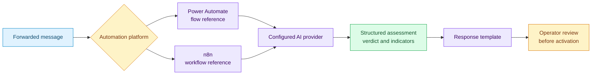

# AI-assisted Email Security

This repository contains adaptable examples for an email-security review workflow. It is a template, not a description of a deployed security operation.

## Review workflow and implementation boundary

Both approaches share a response schema and HTML templates. The workflow exports are starting points: audit their actual branches before enabling mail delivery.

| Start here | What to inspect |
| --- | --- |
| [Power Automate](approach-a-power-automate/README.md) | Flow reconstruction, connection references, and reply templates |
| [n8n](approach-b-n8n/README.md) | Import, OAuth credentials, and outbound mail nodes |
| [Shared schema](shared/ai-response-schema.json) | Required fields and accepted verdict values |
| [Template validation](scripts/validate-templates.sh) | Local checks before importing examples |

**Current limitation:** the n8n export routes verdicts directly to send nodes; it does not implement the confidence-based human-approval gate described in older walkthroughs. Add and test that gate before activation. Email content is included in provider requests, so local hosting alone does not keep that content local.

## Safe adaptation

Configure the following privately for each environment:

- mailbox and activation convention;
- AI provider, model, credentials, and request limits;
- confidence/risk routing rules;
- review, escalation, and any containment actions.

The examples are deliberately provider-neutral. Keep real trigger text, operational thresholds, domain-blocking policy, recipient addresses, and production workflow exports in private configuration or internal documentation. Require human review for any automated action that could affect users, mail delivery, or infrastructure.

## Repository contents

- `approach-a-power-automate/` — workflow example for a managed automation platform.
- `approach-b-n8n/` — workflow example for a self-hosted automation platform.
- `shared/` — schemas and prompt templates.
- `docs/` — implementation notes and troubleshooting guidance.

Never commit API keys, production mailbox addresses, or organization-specific operating procedures.
